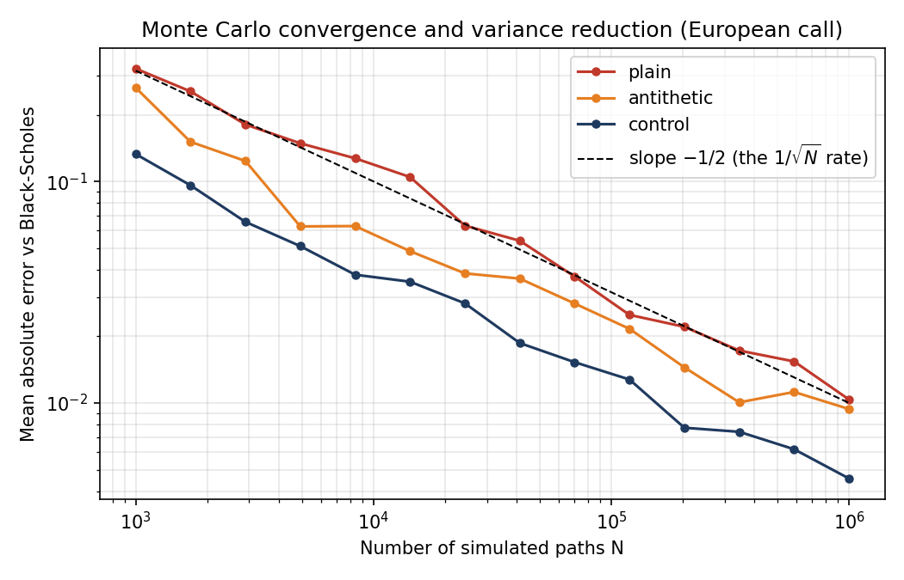

# Monte Carlo Option Pricing with Variance Reduction

A small Python project that prices options by simulation and shows how much
faster the estimate converges when you use variance reduction techniques.

It prices two options under geometric Brownian motion:

- a **European call**, which has an exact Black-Scholes price to check against;
- an **arithmetic-average Asian call**, which has no closed-form price and is
  the kind of problem Monte Carlo is actually used for.

## Methods compared

| Method | Idea |
| --- | --- |
| Plain | Average the discounted payoff over N random paths |
| Antithetic variates | Pair each random draw Z with -Z so the noise partly cancels |
| Control variates | Subtract the noise of a related quantity whose true mean is known |

For the European call the control is the discounted terminal price, whose
expectation is exactly S0. For the Asian call it is the geometric-average
Asian call, which has a closed-form price and moves almost in lockstep with the
arithmetic one.

## Run it

```bash
pip install -r requirements.txt
python mc_options.py                 # default: 200,000 paths
python mc_options.py --paths 1000000
```

It first runs a self-check (every estimator must agree with Black-Scholes to
within 4 standard errors), then prints a table of estimates, standard errors and
the variance reduction factor for each method, and saves `convergence.png`.

## Example output (S0=100, K=105, r=3%, sigma=20%, T=1, N=200,000)

| Option | Method | Estimate | Std error | Variance reduction |
| --- | --- | --- | --- | --- |
| European call (exact 7.1281) | plain | 7.1398 | 0.02804 | 1.0x |
| | antithetic | 7.1283 | 0.02309 | 1.5x |
| | control variate | 7.1360 | 0.01361 | 4.2x |
| Asian call | plain | 3.2106 | 0.01389 | 1.0x |
| | antithetic | 3.2183 | 0.01187 | 1.4x |
| | control variate | 3.2248 | 0.00044 | 977x |

The geometric-Asian control variate gives roughly a thousand-fold reduction in
variance, which is the same accuracy as running about a thousand times more
paths.



## What the maths says

Under risk-neutral GBM, S_T = S0 exp((r - sigma^2/2)T + sigma sqrt(T) Z) with Z ~ N(0,1).
The Monte Carlo error falls like 1/sqrt(N), which is the dashed slope on the
plot. Variance reduction does not change that rate. It lowers the constant in
front of it.

A control variate estimator is Y - b(X - E[X]) with b = Cov(Y,X)/Var(X). Its
variance is Var(Y)(1 - rho^2), where rho is the correlation between the payoff
Y and the control X, so the higher the correlation, the bigger the gain.

## Ideas to extend it

- Add a put via put-call parity and check it against the closed form.
- Estimate the Greeks (delta, vega) by pathwise or finite-difference methods.
- Replace constant volatility with Heston stochastic volatility.
- Try quasi-random (Sobol) sequences instead of pseudo-random numbers.
